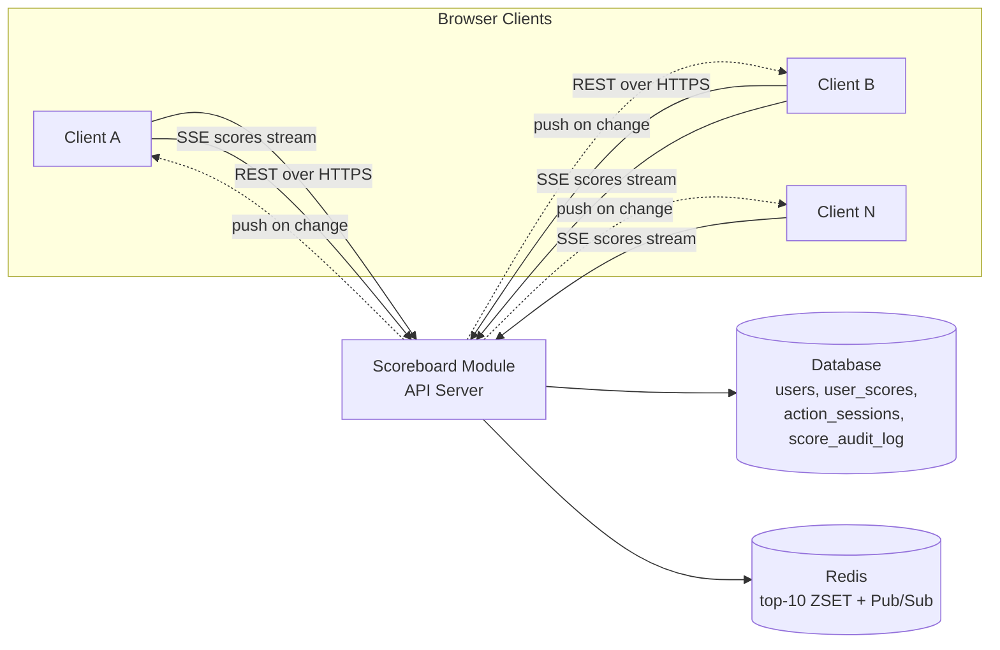
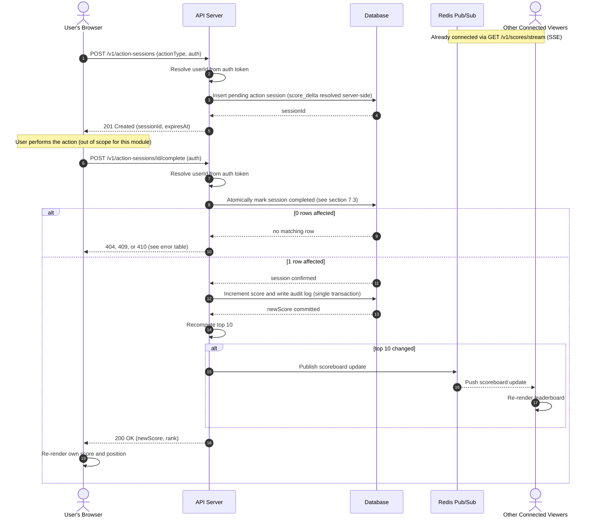

# Problem 6: Live Scoreboard API Module — Specification

## Status

This is a **specification document**, not an implementation. It is
written to be handed to a backend engineering team to build. Section
[Additional Comments & Open Questions](#additional-comments--open-questions)
calls out decisions that were made unilaterally to keep the spec concrete,
and should be confirmed with product/security stakeholders before or
during implementation.

## 1. Overview

This module lets an existing web application:

1. Show a **live-updating** scoreboard of the **top 10** user scores.
2. Let a user's score increase by **1 point** when they complete an
   in-app action (the action's own logic is out of scope — this module
   only cares about the moment it completes).
3. Do the above **without letting a malicious client fabricate score
   increases** — the single hardest requirement here, and the one that
   shapes most of the design below.

This is a **module inside the existing API application server**, not a
new standalone service — it adds a `ScoreboardModule` (routes,
services, and two new-ish DB tables) to the existing backend, and
reuses whatever authentication (login/session/JWT) the rest of the app
already has.

## 2. Goals / Non-Goals

**Goals**

- Authenticated users' scores increase by exactly the intended amount,
  exactly once, per completed action.
- The top-10 leaderboard updates in every connected client's browser
  within roughly a second of a change, without the client polling.
- A believable attacker (someone who opens devtools and replays/edits
  a request) cannot inflate their own or anyone else's score.

**Non-Goals**

- What the "action" actually is (a game level, a quiz, a click — the
  module doesn't know or care).
- Anti-cheat for the action's *client-side gameplay itself* (e.g.
  detecting an aim-bot in a game) — this module only guarantees that
  **the score-increment API call** cannot be abused. See
  [§7.6](#76-what-this-design-does-not-solve) for the honest limits of that guarantee.
- User registration/login/session management (assumed to already exist
  in the host application; this module only *consumes* the resulting
  identity).

## 3. High-Level Architecture



- **API Server**: existing application server; this spec adds a
  `ScoreboardModule` to it (routes in [§5](#5-api-specification)).
- **Database**: whatever relational database the host app already
  uses — this spec doesn't require a specific one. It's the source of
  truth for scores and the anti-replay ledger; no new DB technology is
  introduced for correctness, only for scale (Redis, optional at
  launch — see [§8](#8-scalability-considerations)).
- **Redis**: *optional at launch, recommended before this needs to
  scale past one API instance.* Used for (a) a top-10 sorted-set cache
  so reads don't hit the primary database, and (b) a Pub/Sub channel so
  a score change on API instance A reaches clients connected to
  instance B. See [§8](#8-scalability-considerations).
- **SSE (Server-Sent Events)**, not WebSocket, for the live channel —
  see [§6](#6-real-time-update-mechanism) for why.

## 4. Data Model

Assumes a `users` table already exists. New/changed tables, written in
plain, close-to-ANSI SQL — swap in whatever your database calls a
server-generated UUID, an auto-incrementing/identity column, and a
timestamp type; nothing here is tied to a specific vendor:

```sql
-- One row per user; separated from `users` so hot score writes don't
-- lock/bloat the users table.
CREATE TABLE user_scores (
  user_id     BIGINT PRIMARY KEY REFERENCES users(id),
  score       BIGINT NOT NULL DEFAULT 0,
  updated_at  TIMESTAMP NOT NULL DEFAULT CURRENT_TIMESTAMP
);

-- One row per "I'm about to do the action" -> "I finished it" cycle.
-- This is the anti-replay/anti-forgery ledger described in §7.
CREATE TABLE action_sessions (
  id            CHAR(36) PRIMARY KEY,  -- server-generated UUID
  user_id       BIGINT NOT NULL REFERENCES users(id),
  action_type   VARCHAR(50) NOT NULL,
  status        VARCHAR(20) NOT NULL DEFAULT 'pending', -- pending | completed | expired
  score_delta   INT NOT NULL,           -- resolved server-side at creation, see §7.2
  created_at    TIMESTAMP NOT NULL DEFAULT CURRENT_TIMESTAMP,
  expires_at    TIMESTAMP NOT NULL,
  completed_at  TIMESTAMP
);
CREATE INDEX idx_action_sessions_user ON action_sessions(user_id);
CREATE INDEX idx_action_sessions_expiry ON action_sessions(status, expires_at);

-- Immutable audit trail of every score change, for abuse investigation
-- and to make a bad increment reversible.
CREATE TABLE score_audit_log (
  id                 BIGINT PRIMARY KEY,  -- auto-incrementing / identity column
  user_id            BIGINT NOT NULL REFERENCES users(id),
  action_session_id  CHAR(36) REFERENCES action_sessions(id),
  delta              INT NOT NULL,
  resulting_score    BIGINT NOT NULL,
  ip_address         VARCHAR(45),  -- long enough for IPv4 or IPv6
  created_at         TIMESTAMP NOT NULL DEFAULT CURRENT_TIMESTAMP
);
```

`action_sessions.status` transitions `pending -> completed` exactly
once via an atomic conditional update (§7.3) — this is the core
anti-replay mechanism, not just a status label.

## 5. API Specification

All endpoints require the host app's existing authentication (assume
`Authorization: Bearer <JWT>`; adapt to whatever session mechanism the
app already uses — the important property is just that the server can
resolve **a trusted `userId`** from it).

### 5.1 `POST /v1/action-sessions`

Called when the user **starts** the action (not when they finish it).

Request:
```json
{ "actionType": "puzzle_complete" }
```

Response `201 Created`:
```json
{
  "sessionId": "b3b7c2b0-...-uuid",
  "expiresAt": "2026-08-23T10:15:30Z"
}
```

- `expiresAt` is set server-side (e.g. `now() + expectedActionDuration`
  for that `actionType`, with sane defaults — see
  [open question §9.3](#93-per-action-configuration)). It should be
  long enough for a genuine user to finish, short enough that a stolen
  token is useless minutes later.
- The `score_delta` for this `actionType` is resolved and stored on the
  session **now**, server-side, from a config/lookup table — **never**
  accepted from the client at any point in this flow. This single rule
  is what stops the most naive attack ("just POST `{ delta: 999999 }`").

### 5.2 `POST /v1/action-sessions/{sessionId}/complete`

Called when the user **finishes** the action.

Request: empty body (nothing besides the path param + auth header is
trusted anyway).

Response `200 OK`:
```json
{ "userId": 42, "newScore": 1350, "rank": 7 }
```

Server-side, in order (detailed reasoning in [§7](#7-security--anti-cheat-design)):

1. Resolve `userId` from the auth token.
2. Atomically flip the session `pending -> completed` **iff** it
   belongs to this `userId`, is still `pending`, and `expires_at` is in
   the future. Zero rows affected -> reject (see error table below).
3. In the same DB transaction: `UPDATE user_scores SET score = score +
   session.score_delta`, and insert one `score_audit_log` row.
4. Recompute whether the top-10 set/order changed.
5. If it changed, publish the new top-10 snapshot to the real-time
   channel (§6).
6. Return the caller's own new score and rank.

Error responses:

| Status | Body `error`         | Cause                                             |
|--------|-----------------------|----------------------------------------------------|
| 401    | `UNAUTHENTICATED`     | Missing/invalid auth token                        |
| 404    | `SESSION_NOT_FOUND`   | Unknown `sessionId`, or belongs to another user*   |
| 409    | `SESSION_ALREADY_USED`| Session already `completed` (replay attempt)       |
| 410    | `SESSION_EXPIRED`     | Past `expires_at`                                  |
| 429    | `RATE_LIMITED`        | Too many requests (§7.5)                           |

\* Deliberately the same `404` for "doesn't exist" and "belongs to
someone else" — a `403` would confirm to an attacker that the
`sessionId` they're probing is real, just not theirs.

### 5.3 `GET /v1/scores/top`

Fallback for the initial page load and for clients before their SSE
connection is established.

Response `200 OK`:
```json
{
  "generatedAt": "2026-08-23T10:15:31Z",
  "entries": [
    { "rank": 1, "userId": 7, "username": "alice", "score": 4820 },
    { "rank": 2, "userId": 3, "username": "bob",   "score": 4715 }
  ]
}
```

### 5.4 `GET /v1/scores/stream` (SSE)

Long-lived connection; see [§6](#6-real-time-update-mechanism).

- On connect: server immediately sends a `scoreboard:init` event with
  the current top-10 (identical shape to §5.3), so the client has data
  before the first live update ever fires.
- On any score change that alters the top-10 set or ordering: server
  sends a `scoreboard:update` event with the new top-10.
- Heartbeat comment (`:\n\n`) every ~15s to keep proxies from closing
  the idle connection.

## 6. Real-Time Update Mechanism

**Recommendation: Server-Sent Events (SSE), not WebSocket.**

The data only ever flows server -> client on this channel (the client
never sends anything over it — score changes always go through the
normal authenticated POST in §5.2). SSE gives us that one-directional
push over plain HTTP with:

- Built-in reconnect + `Last-Event-ID` in every browser's native
  `EventSource`, no extra client library.
- Works through standard HTTP infrastructure (proxies, load balancers)
  that some environments are cagier about for raw WebSocket upgrades.

Use WebSocket instead only if a future requirement needs the client to
push data over the same channel (out of scope today).

**Flow:** a score-changing request is handled by *some* API instance,
which needs to notify *every* client connected to *any* instance. With
a single instance this is an in-process event emitter; with more than
one instance, it requires a shared broadcast layer (Redis Pub/Sub is
the default choice given Redis is already recommended for the top-10
cache — see [§8](#8-scalability-considerations)). **This is the one
piece of this spec that must be designed for >1 instance from day one**,
because retrofitting fan-out after clients are already relying on "live"
updates is a much bigger migration than starting with it.

## 7. Security & Anti-Cheat Design

The requirement "prevent malicious users from increasing scores without
authorisation" is really three overlapping problems, addressed by three
independent layers — an attacker has to beat all three, not just one:

### 7.1 Authentication — is this a real, logged-in user?

Every scoring endpoint requires the same auth the rest of the app uses.
No `userId` is ever accepted from the request body/query — it's always
derived from the verified token, so a client cannot claim to be another
user.

### 7.2 Server-controlled score delta — how much is a completion worth?

The client **never** sends a point value. The amount is resolved
server-side from `actionType` when the session is created (§5.1) and
stored on the session row, so the same number is used at completion
time — a client editing the request body has nothing to edit that
matters.

### 7.3 One-time, ownership-checked, expiring session tokens — did this completion actually happen once, for this user, in a plausible timeframe?

This is the core anti-replay mechanism, and it only works if the state
transition is **atomic**:

```sql
UPDATE action_sessions
SET status = 'completed', completed_at = CURRENT_TIMESTAMP
WHERE id = :sessionId
  AND user_id = :authenticatedUserId
  AND status = 'pending'
  AND expires_at > now();
-- if affected rows = 0 -> reject the request (see error table in §5.2)
```

A single conditional `UPDATE` (not a `SELECT` then `UPDATE`) is
important — it closes the race where two concurrent requests for the
same session both pass a separate read-check before either writes,
which would double-award the points. Concretely, this stops:

- **Replay**: resubmitting the same completion twice — the second
  `UPDATE` affects 0 rows, since `status` is no longer `'pending'`.
- **Token forgery**: `sessionId` is a random UUID (v4, 122 bits of
  randomness) — not guessable/enumerable.
- **Cross-account use**: the `user_id` check means a token stolen from
  another user's request is still bound to *their* account, not the
  attacker's — it can't be used to award the attacker points.
- **Farming tokens far in advance**: `expires_at` bounds how long a
  session can sit around unused.

### 7.4 What this alone does *not* stop

Nothing above stops a user from calling `POST /action-sessions` then
immediately `POST .../complete` in a tight script, never actually
performing the action, *if* the action itself has no server-verifiable
side effect. That is a fundamental limit of a generic "action" this
spec is deliberately blind to (see [§7.6](#76-what-this-design-does-not-solve)) — it's mitigated, not solved, by §7.5's rate limiting and §9.6's suggested anomaly detection.

### 7.5 Rate limiting

Per-`userId` (primary) and per-IP (secondary, catches multi-account
abuse from one source) limits on both endpoints in §5.1/§5.2 — e.g. a
sliding window of N action-completions per minute, N chosen from the
fastest *realistic* completion cadence for the fastest `actionType`.
Returns `429` (see error table). This is a blunt instrument on top of
§7.3, not a replacement for it.

### 7.6 What this design does not solve

Being upfront about the honest limits, so the team doesn't over-promise
to stakeholders: if the "action" is something like "watch a 30-second
video" and completion is purely a client-side timer with no
server-side signal, no API-layer design can distinguish a genuine
30-second wait from a script that just sleeps 30 seconds and calls the
same endpoint. Closing that gap requires the *action itself* to give
the server something to verify (a proof-of-work, a server-side timer
the client can't rush, a per-action-type check written specifically for
that action) — which is explicitly out of scope per [§2](#2-goals--non-goals),
since this spec doesn't know what the action is.

### 7.7 Transport & storage

HTTPS everywhere (non-negotiable — an auth token or session ID over
plain HTTP defeats everything above). Standard practice otherwise:
short-lived JWTs / rotated session tokens per the host app's existing
policy — this module doesn't introduce a new auth scheme.

## 8. Scalability Considerations

- **Top-10 reads**: recomputing `ORDER BY score DESC LIMIT 10` against
  the primary database on every single completion (to check "did the
  top-10 change?") is fine at low volume and a real bottleneck at high
  volume. Recommended: maintain a Redis `ZSET` (`ZADD scoreboard
  <score> <userId>`) updated alongside the database write, and read
  the top-10 from Redis (`ZREVRANGE scoreboard 0 9 WITHSCORES`) —
  O(log N) update, O(log N + 10) read. The primary database stays the
  source of truth (survives a Redis flush); Redis is a derived,
  rebuildable cache.
- **Fan-out**: as noted in [§6](#6-real-time-update-mechanism), more
  than one API instance needs a shared Pub/Sub (Redis Pub/Sub is the
  natural choice given Redis is already in the stack for the point
  above) so a write on instance A reaches SSE connections on instance
  B.
- **SSE connection count**: each open SSE connection holds a server
  thread/socket open. At meaningfully large concurrent-viewer counts,
  confirm the runtime/framework handles that connection count
  efficiently (e.g. an event-loop-based server rather than
  thread-per-connection), and load-test before launch (§9.9).

## 9. Additional Comments & Open Questions

Explicit call-outs of decisions made to keep this spec concrete, and
things worth confirming with product/security before or during build:

### 9.1 Tie-breaking

Not specified in the requirements. This spec assumes ties are broken by
**earliest to reach that score** (rewards being first), which requires
ordering by `(score DESC, updated_at ASC)` rather than score alone —
otherwise the displayed top-10 order can flicker/reorder on unrelated
writes. **Needs product sign-off** — "most recent first" is an equally
valid product choice, just a different one.

### 9.2 Does the leaderboard need history?

Current schema only stores current score. If "score over time" /
weekly leaderboards / a personal score graph are on any near-term
roadmap, it's much cheaper to add an append-only events table now than
to backfill history later — worth asking before building.

### 9.3 Per-action configuration

§5.1 assumes a config/lookup table mapping `actionType -> (scoreDelta,
expectedDurationForTTL)`. This spec doesn't define that table's shape
or who manages it (a DB table admins edit? a config file deployed with
the app?) — needs an owner.

### 9.4 Should a user see their own rank even outside the top 10?

Plausible, cheap UX win: have `GET /v1/scores/top` and the SSE payload
optionally include the caller's own `{ rank, score }` alongside the
top-10, computed from the same Redis ZSET (`ZREVRANK`). Not requested,
flagging as a likely-wanted follow-up.

### 9.5 Idempotency on network retry

If a client's network drops right as the `complete` response is
in-flight (request succeeded server-side, response lost), a naive
client retry hits `409 SESSION_ALREADY_USED` — correct from an
anti-cheat standpoint, but the client needs to treat that specific
409 as "actually fine, fetch my current score" rather than a real
error, since from the user's perspective their action did complete.
Worth a line in the frontend integration notes so it isn't reported as
a bug.

### 9.6 Anomaly detection (future work, not launch-blocking)

Rate limiting (§7.5) is a fixed threshold. A further layer — flagging
accounts whose score-gain velocity is a statistical outlier for manual
review, or requiring a step-up challenge (e.g. CAPTCHA) once flagged —
would catch slower/distributed abuse that stays under the rate limit.
Reasonable to defer past initial launch.

### 9.7 Data retention

`score_audit_log` grows forever as written. Needs an explicit retention
policy (e.g. archive/delete after N months) — both for storage cost and
because "how long do we keep per-user activity logs" is frequently a
privacy/compliance question, not just an engineering one.

### 9.8 Reversing a bad increment

`score_audit_log` makes a fraudulent increment *identifiable*, but
there's no defined admin action to reverse one yet. Worth a small
internal "adjust user score with a reason, logged" endpoint before
launch, so support/trust-and-safety isn't asked to do it by hand in
prod.

### 9.9 Load testing

Given the explicit "live update" requirement, the fan-out path (one
write -> broadcast to every connected viewer) is the part most likely
to behave unexpectedly under real concurrent load and is worth a
dedicated load test — pure CRUD throughput on the two REST endpoints is
comparatively low-risk.

## 10. Flow of Execution (Sequence Diagram)

The primary flow this module implements — a user completing an action,
their score updating, and every connected viewer's scoreboard updating
live:



## 11. Summary Checklist for Implementers

- [ ] `action_sessions` state transition is a single atomic conditional
      `UPDATE`, never a read-then-write.
- [ ] Score delta is resolved server-side at session-creation time and
      never re-derived from anything client-supplied.
- [ ] `userId` on every request comes from the verified auth token,
      never from the request body/query.
- [ ] Rate limiting is in place on both `POST` endpoints before launch.
- [ ] The broadcast layer is designed for >1 API instance from the
      start, even if launching on one.
- [ ] Tie-breaking rule (§9.1) is confirmed with product before the
      `ORDER BY` is written.
